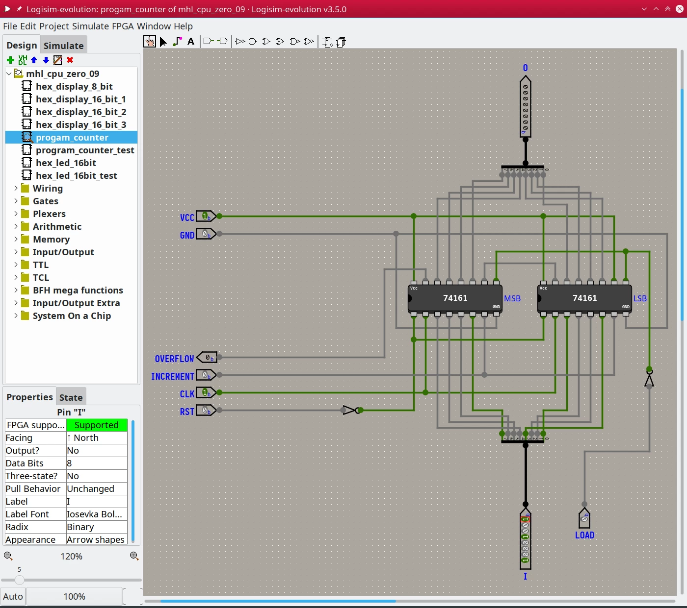
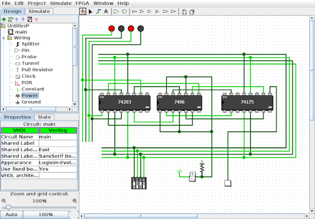

# Logisim-evolution for Exploring and Testing Digital Circuits

A half-adder is small enough to inspect wire by wire, yet it introduces the same questions as a larger processor: which inputs matter, what should each output mean, and when should a stored value change?
The logisim evolution simulator lets you answer these questions with gates, reusable subcircuits, test vectors, and signal traces.

## Specify the answer before connecting gates

For a half-adder, give the two input pins the labels `A` and `B`, and label the output pins `Sum` and `Carry`.
Keep all four pins one bit wide.
Connect XOR to Sum and AND to Carry, then save the circuit under the name `HalfAdder` inside your project.

Use this original test-vector content as a small acceptance specification:

```text
A B Sum Carry
0 0 0 0
0 1 1 0
1 0 1 0
1 1 0 1
```

Load the text through the Test Vector window for the selected circuit.
Headers must match the circuit's pin labels; bus pins need an explicit width such as `A[8]`.
Incorrect outputs are highlighted, making a wiring mistake easier to locate than a long sequence of manual toggles.

- Check every input combination for this two-input example.
- Keep expected outputs separate from observations made while debugging.
- Extend the cases when a later edit adds an enable input or changes the width.

[](https://logisim-evolution-simulator.github.io/Logisim-evolution/)

## Follow a value across clock edges

A combinational circuit answers a question about its current inputs.
A register or counter also depends on stored state, so a passing truth table alone cannot establish its behavior.

### Make reset part of the experiment

1. Choose the register width and its active clock edge.
2. Apply reset and verify the intended initial value.
3. Release reset before the clock transition being examined.
4. Change the data input while the clock is inactive.
5. Advance the clock and compare the output before and after the active edge.

Do not infer a register's initialization policy from a single successful run.
Record the reset polarity and the edge that captures data alongside the circuit.



### Read the chronogram as evidence

Display the clock, reset, input, and output signals together.
An output change should be explainable by a clock event, a reset action, or the behavior of the selected component.
If the waveform disagrees with your expectation, inspect the triggering attributes before changing the gates.

Simulation timing illustrates the digital model; it does not establish the electrical timing margins of a physical board.

## Turn a corrected circuit into a repeatable check

After the half-adder passes interactively, reuse the same vectors from a terminal.
The following native Logisim-evolution command assumes you saved the vector as `half-adder.txt` and the project as `arithmetic.circ`.

```bash
java -jar logisim-evolution.jar --test-vector HalfAdder half-adder.txt arithmetic.circ
```

Replace the JAR filename with the actual release artifact on your machine.
The circuit name is an internal project name, rather than the project filename.
Read the reported pass and failure counts before accepting an edited circuit.

The [official test-vector reference](https://github.com/logisim-evolution/logisim-evolution/blob/main/docs/test_vector.md) explains command arguments and stateful test sequences.
For purely combinational cases, ordinary rows are independent.
For sequential designs, check the sequence features supported by your application version instead of assuming every row preserves state.

Use a subcircuit when the half-adder becomes part of a larger arithmetic unit.
Keep its public pin labels and widths stable, then rerun its checks when changing the implementation.



The supplied [CHANGES.md](CHANGES.md) separates development changes from released history.
Its companion [gradle.properties](gradle.properties) identifies this source snapshot as `5.1.0-dev`, which is not a promise of a stable release.

## Decide what must survive the move to hardware

A logisim evolution circuit designer project can be useful for teaching without ever targeting a board.
For a logisim evolution fpga workflow, the schematic is only one part of the hardware description.

| Review gate | Information required | Evidence to inspect | Continue when |
| --- | --- | --- | --- |
| Circuit validation | Consistent widths and supported components | FPGA design-rule results | Reported issues are resolved |
| Board selection | Device identity and clock parameters | Selected board description | They match the physical board |
| Resource mapping | Switch, LED, and connector assignments | Circuit-to-board mapping | Every required resource has an assignment |
| HDL generation | Supported logic and chosen target language | Generated HDL and constraints | The generated design represents the intended circuit |
| Toolchain run | Compatible external FPGA tools | Synthesis and implementation reports | The external flow accepts the design |

FPGA Commander brings together checking, resource mapping, HDL generation, and the configured external toolchain.
Successful desktop simulation does not guarantee that every component can be synthesized.
Review supported components before committing a large design to a specific board.

The FPGA Board Editor can describe board I/O regions and FPGA parameters.
Use an existing board description only when its device, clock, and connector details match your hardware.
Keep simulation frequency separate from the actual clock configuration used by the board tools.

## Keep the same experiment usable across machines

The standalone JAR needs Java 21 or newer.
Official platform packages include a runtime; use the artifact appropriate to your operating system and processor.

On Linux, a blank window under some non-reparenting window managers has a documented launch workaround.
Substitute your real JAR filename in this command:

```bash
env _JAVA_AWT_WM_NONREPARENTING=1 java -jar logisim-evolution.jar
```

The Snap package recipe is [snapcraft.yaml](snap/snapcraft.yaml).
Its [logisim-evolution-wrapper](snap/local/usr/bin/logisim-evolution-wrapper) passes application arguments through and sets the Java preferences location.
The [configure](snap/hooks/configure) hook adjusts the Snap path handling.
Desktop integration is described by [logisim-evolution.desktop](snap/gui/logisim-evolution.desktop), with [logisim-icon-128.png](snap/gui/logisim-icon-128.png) supplying the packaged icon.

### Identify the source snapshot

The logisim evolution open source project uses Gradle, with application tasks and Java compatibility declared in [build.gradle.kts](build.gradle.kts).
The project name is set in [settings.gradle.kts](settings.gradle.kts).
The launchers [gradlew](gradlew) and [gradlew.bat](gradlew.bat) provide Unix and Windows entry points for a complete checkout.
Wrapper settings live in [gradle-wrapper.properties](gradle/wrapper/gradle-wrapper.properties), alongside [gradle-wrapper.jar](gradle/wrapper/gradle-wrapper.jar).
The [checkstyle-suppressions.xml](checkstyle-suppressions.xml) file records exceptions used by the source style checks.

### Preserve the visual identity when sharing teaching material

The artwork guide [README.md](artwork/README.md) explains rendering requirements and asset locations.
The [update_assets.sh](artwork/update_assets.sh) script generates raster assets from vector artwork and requires its documented external tools.
Editable identity assets are [logisim-evolution-logo.svg](artwork/logisim-evolution-logo.svg) and [logisim-evolution-icon.svg](artwork/logisim-evolution-icon.svg).

The supplied fonts help preserve the intended appearance when rendering editable logo text:

- [Electronic Circuit Font.ttf](artwork/fonts/electronic-circuit/Electronic%20Circuit%20Font.ttf)
- [Electronic Circuit Font.otf](artwork/fonts/electronic-circuit/Electronic%20Circuit%20Font.otf)
- [adrip1.ttf](artwork/fonts/a-dripping-marker/adrip1.ttf)

Check the artwork instructions before substituting fonts or distributing regenerated images.
Keep screenshots readable enough to distinguish pin labels, bus widths, and clock attributes.

## Related Search Terms

logisim evolution simulator, logisim evolution, logisim evolution circuit designer, logisim evolution fpga, logisim evolution open source, digital-logic, digital-circuits, education, fpga, logic-gates, logisim, simulator, timing-diagram, verilog, vhdl
